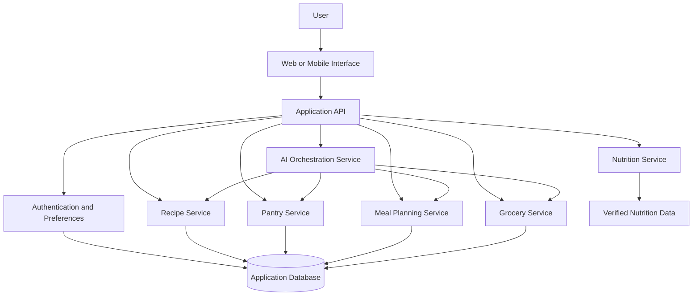

Savorly is an AI-powered culinary intelligence platform designed to
transform the way people discover recipes, plan meals, manage groceries,
understand nutrition, cook food, reduce waste, and build personalized
eating habits.
Instead of functioning as a traditional recipe website, Savorly acts as
a personal food intelligence companion that continuously learns from
a user's preferences, dietary requirements, available ingredients,
cooking behavior, nutrition goals, budget, pantry inventory, and meal
history.
🌟 Vision
Savorly aims to become a personal AI food operating system.
The platform brings together:
- 🤖 Artificial Intelligence
- 🧠 Machine Learning
- 🥗 Nutrition Intelligence
- 🍳 Recipe Intelligence
- 🛒 Grocery Intelligence
- 🏠 Pantry Intelligence
- 💰 Budget Intelligence
- ♻️ Food Waste Intelligence
- 📊 Food Analytics
- 🎙️ Voice Interaction
- 📷 Computer Vision
- 🌍 Culinary Knowledge
The long-term vision is to help users answer:
"What should I eat, what can I make, what do I need to buy, how
should I cook it, and how can I eat better?"

from a single intelligent platform.
🚨 The Problem
Modern food applications are fragmented. A user may need:
- One application for recipes
- Another for meal planning
- Another for calorie tracking
- Another for grocery lists
- Another for pantry management
- Another for food budgeting
- Another for cooking instructions
These applications rarely understand the complete context of the user's
food life.
For example, a user has:
2 Tomatoes
1 Onion
Rice
Eggs
Spinach
₹250 Budget
30 Minutes Available
High Protein Goal
Vegetarian Preference
Savorly aims to use this context to suggest suitable recipes, identify
missing ingredients, estimate costs, plan meals, and help reduce food
waste. Dietary rules must be explicit and configurable; for example,
some vegetarian users eat eggs while others do not.
📖 Table of Contents
- Core Objectives
- Core Features
- AI Intelligence Modules
- Example User Journey
- System Architecture
- Proposed Technology Stack
- Project Structure
- Getting Started
- Environment Variables
- Proposed API Design
- Data Model
- Privacy and Responsible AI
- Testing
- Roadmap
- Contributing
- License
🎯 Core Objectives
- Recommend recipes based on available ingredients and user
  preferences.
- Create practical meal plans that account for time and budget.
- Maintain a pantry inventory and highlight ingredients nearing
  expiry.
- Generate grocery lists from recipes and meal plans.
- Provide nutrition estimates with clear uncertainty and data sources.
- Personalize recommendations using explicit feedback and meal
  history.
- Support cooking instructions that are easy to follow.
- Help users make use of ingredients they already own.
- Provide accessible experiences across desktop and mobile devices.
✨ Core Features
🍳 1. Smart Recipe Discovery
- Search recipes by name, ingredient, cuisine, or category.
- Filter by preparation time, difficulty, budget, and dietary
  preference.
- Recommend recipes based on available pantry ingredients.
- Show missing ingredients before a user starts cooking.
- Save favorite recipes and cooking history.
- Offer substitutions where suitable and safe.
- Display ingredient quantities and step-by-step instructions.
🏠 2. Pantry Intelligence
- Add, edit, and remove pantry items.
- Track quantities and units.
- Store purchase and expiry dates where provided.
- Highlight items that may need to be used soon.
- Suggest recipes that prioritize available ingredients.
- Support manual entry and planned barcode or image-assisted entry.
Expiry alerts should use user-provided dates and avoid claiming that a
food is safe or unsafe based only on an AI prediction.
📅 3. Personalized Meal Planning
- Create daily or weekly meal plans.
- Consider available time, budget, and preferences.
- Allow breakfast, lunch, dinner, and snack planning.
- Reuse ingredients across meals to reduce waste.
- Swap meals and regenerate plans.
- Generate a grocery list from the selected plan.
- Track meals as planned, cooked, or skipped.
🛒 4. Grocery Intelligence
- Create grocery lists manually or from meal plans.
- Combine duplicate ingredients and compatible units.
- Separate pantry items from items to purchase.
- Organize lists by category.
- Estimate costs when price data is available.
- Track purchased items.
- Support future integration with grocery providers.
Price estimates should be labeled as estimates unless they come from a
current, verified source.
🥗 5. Nutrition Intelligence
- Display estimated calories and macronutrients when reliable
  ingredient data is available.
- Show serving sizes and ingredient quantities.
- Support user-defined nutrition goals.
- Compare estimated nutrition across recipes.
- Identify missing or uncertain nutrition data.
- Keep dietary preferences separate from medical advice.
Nutrition calculations depend on ingredient quantities, preparation
methods, brands, and serving sizes. They should not be presented as
exact when the source data is incomplete.
💰 6. Budget Intelligence
- Set a daily or weekly food budget.
- Estimate recipe and meal-plan costs.
- Prioritize ingredients already in the pantry.
- Suggest lower-cost alternatives where appropriate.
- Track estimated versus recorded spending.
- Highlight when a plan exceeds the chosen budget.
♻️ 7. Food Waste Intelligence
- Prioritize ingredients approaching their user-entered expiry dates.
- Recommend recipes that use leftover ingredients.
- Identify overlapping ingredients across planned meals.
- Track approximate ingredient usage.
- Provide practical storage guidance from reviewed sources.
👨‍🍳 8. Guided Cooking Mode
- Present instructions one step at a time.
- Show ingredient quantities beside relevant steps.
- Include timers where supported.
- Allow users to mark steps complete.
- Support substitutions and serving adjustments.
- Plan future voice-guided cooking interactions.
🎙️ 9. Voice Interaction --- Planned
- Search for recipes by voice.
- Ask for the next cooking step.
- Request ingredient substitutions.
- Add items to a grocery list using speech.
- Support hands-free interactions where the device and browser allow
  it.
📷 10. Computer Vision --- Planned
Potential future capabilities include:
- Recognizing ingredients from uploaded photographs.
- Suggesting pantry items for user confirmation.
- Reading supported product labels.
- Assisting with receipt item extraction.
Image recognition must request user confirmation before making
consequential pantry or nutrition updates.
📊 11. Food Analytics
- Summarize cooking activity.
- Track planned versus completed meals.
- Show pantry usage and food-waste estimates.
- Track budget trends.
- Review favorite cuisines and recipes.
- Visualize progress toward user-selected goals.
Analytics should explain how metrics are calculated and avoid implying
that food choices alone determine health outcomes.
🧠 12. Personalized Recommendations
- Learn from recipe ratings and explicit feedback.
- Respect allergies and excluded ingredients.
- Consider available ingredients, budget, and cooking time.
- Balance familiar favorites with new recipe suggestions.
- Explain why a recipe was recommended.
- Allow users to reset or adjust personalization.
Allergies and excluded ingredients must be treated as hard constraints
rather than optional ranking preferences.
🤖 AI Intelligence Modules
Savorly can be organized into separate services that cooperate through
well-defined interfaces.
Recipe Intelligence
Ranks recipes using ingredient availability, preparation time, user
preferences, and suitability constraints.
Meal Planning Intelligence
Builds meal plans from selected recipes while considering budget,
schedule, serving size, and variety.
Grocery Intelligence
Converts meal plans into consolidated ingredient lists and estimates
costs when reliable price data exists.
Nutrition Intelligence
Calculates or retrieves nutrition estimates from structured ingredient
data and records the source and uncertainty.
Pantry Intelligence
Tracks inventory, quantity changes, user-provided expiry dates, and
potential ingredient reuse.
Recommendation Engine
Uses explicit feedback, saved recipes, and interaction history to
personalize suggestions.
AI Assistant
Interprets natural-language requests such as:
"Suggest a quick dinner using what I have, under my remaining budget."

The assistant should use structured application data for inventory,
prices, and nutrition rather than inventing them.
Responsible AI Requirements
- Respect allergies and user-defined exclusions.
- Clearly label estimates and uncertain data.
- Avoid medical diagnosis or treatment claims.
- Do not invent ingredient availability or current prices.
- Ask users to confirm uncertain image recognition.
- Provide a non-AI path for core features.
Implementation status: These modules describe the intended product
architecture. Mark them as implemented only after verifying the
corresponding code and tests.

🧭 Example User Journey
A user enters the following information:
- Pantry: tomatoes, onion, rice, spinach, and eggs
- Budget: ₹250
- Available cooking time: 30 minutes
- Goal: higher-protein meals
- Dietary preference: vegetarian, with an explicit choice about eggs
Savorly could then:
1. Identify recipes compatible with the user's confirmed dietary rules.
2. Rank recipes that use the most available ingredients.
3. Estimate preparation time and ingredient costs.
4. Show any missing ingredients.
5. Generate a grocery list within the remaining budget, if price data
   is available.
6. Provide step-by-step cooking guidance.
7. Let the user record the meal and provide feedback.
8. Use that feedback to improve future recommendations.
All recipe, cost, and nutrition outputs should be presented as estimates
unless validated by reliable data.
🏗️ System Architecture
The following is a proposed architecture for a full-stack
implementation.

Architecture Principles
- Keep UI, business logic, and data access separated.
- Validate all user input on the server.
- Enforce dietary exclusions and allergy constraints consistently.
- Store API secrets only on the backend.
- Track the source of price and nutrition data.
- Make AI services optional for core workflows.
- Record user consent and provide controls for personalization data.
🛠️ Proposed Technology Stack
Choose technologies according to the existing repository and project
scope.
  Layer                   Proposed Technologies   Purpose
  Frontend                React, TypeScript, Vite Responsive web
                                                  interface
  Styling                 Tailwind CSS            Design system and
                                                  responsive layouts
  Backend                 Node.js, Express,       REST API and business
                          TypeScript              logic
  AI services             Python, FastAPI         AI and recommendation
                                                  endpoints
  Database                PostgreSQL              Users, recipes, pantry,
                                                  and meal plans
  Data access             Prisma or SQLAlchemy    Database access and
                                                  migrations
  Machine learning        scikit-learn            Recommendation and
                                                  ranking experiments
  Image support           Managed vision API or   Optional ingredient
                          suitable model          recognition
  Testing                 Vitest, Playwright,     Unit, integration, and
                          Pytest                  end-to-end tests
  Deployment              Vercel plus a backend   Frontend and API
                      hosting service         hosting
This stack is a proposal, not a statement that all listed tools are
already installed or implemented.
📂 Project Structure
One possible full-stack repository structure:
savorly/
├── frontend/
│   ├── public/
│   ├── src/
│   │   ├── assets/
│   │   ├── components/
│   │   │   ├── common/
│   │   │   ├── recipes/
│   │   │   ├── pantry/
│   │   │   ├── meal-planner/
│   │   │   └── grocery/
│   │   ├── pages/
│   │   ├── hooks/
│   │   ├── services/
│   │   ├── types/
│   │   ├── utils/
│   │   ├── App.tsx
│   │   └── main.tsx
│   ├── package.json
│   └── vite.config.ts
├── backend/
│   ├── src/
│   │   ├── config/
│   │   ├── middleware/
│   │   ├── routes/
│   │   ├── controllers/
│   │   ├── services/
│   │   ├── validators/
│   │   ├── repositories/
│   │   ├── app.ts
│   │   └── server.ts
│   ├── tests/
│   └── package.json
├── ai-service/
│   ├── app/
│   │   ├── routers/
│   │   ├── services/
│   │   ├── models/
│   │   └── main.py
│   ├── tests/
│   └── requirements.txt
├── docs/
├── .env.example
├── .gitignore
└── README.md
Adapt this suggested structure to the actual repository.
⚙️ Getting Started
Prerequisites
- Node.js and npm for the frontend.
- Python, if the optional AI service is implemented.
- PostgreSQL, if the application uses the proposed database.
- Git and a code editor.
1. Clone the Repository
Replace the URL with your actual repository URL.
git clone YOUR_REPOSITORY_URL
cd savorly
2. Install Frontend Dependencies
Run from the frontend directory:
cd frontend
npm install
3. Start the Frontend
npm run dev
Open the local URL printed by the development server, often
http://localhost:5173.
4. Run the Backend
If the backend exists, follow its package scripts. For a typical Node.js
service:
cd backend
npm install
npm run dev
5. Run the AI Service
If the Python AI service exists and its dependencies are configured:
cd ai-service
python -m venv .venv
Activate the virtual environment, then install the project's
requirements:
pip install -r requirements.txt
Start the service using the command documented by its implementation.
These are example workflows. Confirm the actual folder names and
commands in the repository before running them.

🔐 Environment Variables
Create local environment files only for services that are actually
implemented.
Example .env.example:
NODE_ENV=development
PORT=5000
DATABASE_URL=your_database_connection_string
SESSION_SECRET=replace_with_a_long_random_secret
AI_PROVIDER_API_KEY=your_server_side_api_key
NUTRITION_PROVIDER_API_KEY=your_nutrition_provider_key
CLIENT_URL=http://localhost:5173
Security Rules
- Never commit real .env files or API keys.
- Keep provider secrets on the server.
- Use separate development and production credentials.
- Validate uploads and restrict file sizes and types.
- Apply authorization to personal food history and profile data.
- Avoid logging sensitive personal information.
- Request permission before using optional personalization data.
🔌 Proposed API Design
These endpoints are examples for a future API and are not claims that
they already exist.
  Method                  Endpoint                        Purpose
  GET                     /api/recipes                  Search and filter
                                                          recipes
  GET                     /api/recipes/:id              Retrieve a recipe
  POST                    /api/recipes/recommend        Request personalized
                                                          recommendations
  GET                     /api/pantry                   Retrieve the user's
                                                          pantry
  POST                    /api/pantry/items             Add a pantry item
  PATCH                   /api/pantry/items/:id         Update a pantry item
  DELETE                  /api/pantry/items/:id         Remove a pantry item
  GET                     /api/meal-plans               Retrieve saved meal
                                                          plans
  POST                    /api/meal-plans               Create a meal plan
  POST                    /api/grocery-lists/generate   Generate a grocery list
  GET                     /api/nutrition/recipe/:id     Retrieve available
                                                          nutrition estimates
  POST                    /api/feedback                 Save user feedback
  POST                    /api/assistant/query          Submit an assistant
                                                      request
Every personal endpoint should authenticate the user and authorize
access to the requested data.
🗄️ Data Model
A proposed data model may include:
  Entity                Purpose
  Users                 Account identity and preferences
  Dietary Preferences   Diet type and excluded ingredients
  Allergies             User-declared allergy constraints
  Recipes               Ingredients, servings, instructions, and source
  Recipe Ingredients    Quantities and units for each recipe
  Pantry Items          Inventory quantity and optional expiry date
  Meal Plans            Planned meals by date and meal type
  Meal Plan Items       Recipes assigned to a meal plan
  Grocery Lists         Items needed for shopping
  Grocery List Items    Quantity, category, and purchase status
  Nutrition Records     Nutrient values, source, and serving basis
  Recipe Feedback       Ratings, saves, and user feedback
  Food Activity         User-recorded cooking and meal events
Data Quality Principles
- Store ingredient quantities with explicit units.
- Distinguish user-entered values from inferred values.
- Track nutrition and price sources where available.
- Avoid treating missing data as zero.
- Keep allergies and excluded ingredients as hard constraints.
- Allow users to correct pantry and recipe information.
🔒 Privacy and Responsible AI
Savorly may process personal preferences, food history, allergies, and
nutrition goals. These details should be handled carefully.
Recommended safeguards:
- Collect only data needed for the requested features.
- Explain why personal information is requested.
- Provide controls to edit or delete stored preferences.
- Protect accounts and private data with appropriate access controls.
- Do not sell or expose personal food histories without valid
  authorization.
- Do not infer medical conditions from food choices.
- Avoid presenting meal suggestions as medical treatment.
- Encourage qualified professional guidance for medical nutrition
  needs.
- Clearly label estimated nutrition, costs, and AI-generated
  suggestions.
🧪 Testing
Test the application at multiple levels.
Example Frontend Commands
npm run build
npm run test
Example End-to-End Command
npx playwright test
These commands require matching scripts and dependencies in the project.
Important Test Scenarios
- Recipe search and filtering.
- Dietary preference and allergy exclusions.
- Pantry quantity updates.
- Meal plan generation within time and budget constraints.
- Grocery list consolidation.
- Nutrition estimates with missing ingredient data.
- Authentication and access control.
- Recommendation feedback and personalization.
- Invalid input and unavailable external services.
- Responsive layout and accessibility.
🗺️ Development Roadmap
Phase 1: Core Experience
- [ ] Responsive application shell.
- [ ] Recipe discovery and recipe detail pages.
- [ ] User preference settings.
- [ ] Pantry item management.
Phase 2: Planning and Shopping
- [ ] Meal planner.
- [ ] Grocery list generation.
- [ ] Time and budget filters.
- [ ] Ingredient substitutions.
Phase 3: Food Intelligence
- [ ] Nutrition data integration.
- [ ] Ingredient availability ranking.
- [ ] Food waste reduction suggestions.
- [ ] Personalized recommendations.
Phase 4: AI Interaction
- [ ] Natural-language food assistant.
- [ ] Guided cooking mode.
- [ ] Voice interaction.
- [ ] Image-assisted pantry entry with confirmation.
Phase 5: Analytics and Reliability
- [ ] Food activity analytics.
- [ ] Recommendation evaluation.
- [ ] Privacy and security review.
- [ ] Automated tests and monitoring.
- [ ] Accessibility and performance improvements.
Mark features complete only when they have been implemented and tested.
🤝 Contributing
Contributions, bug reports, and feature suggestions are welcome.
1. Fork the repository.
2. Create a feature branch:
   git checkout -b feature/your-feature
3. Implement and test your changes.
4. Commit your changes:
   git commit -m "feat: describe your change"
5. Push your branch:
   git push origin feature/your-feature
6. Open a pull request describing the changes.
📄 License
Choose and add a license file before claiming a specific license. If
this project is intended to use the MIT License, include a matching
LICENSE file in the repository.
::: {align="center"}
## 🍽️ SAVORLY

**Discover better. Cook smarter. Waste less.**

*Your personal food intelligence companion.*
:::
